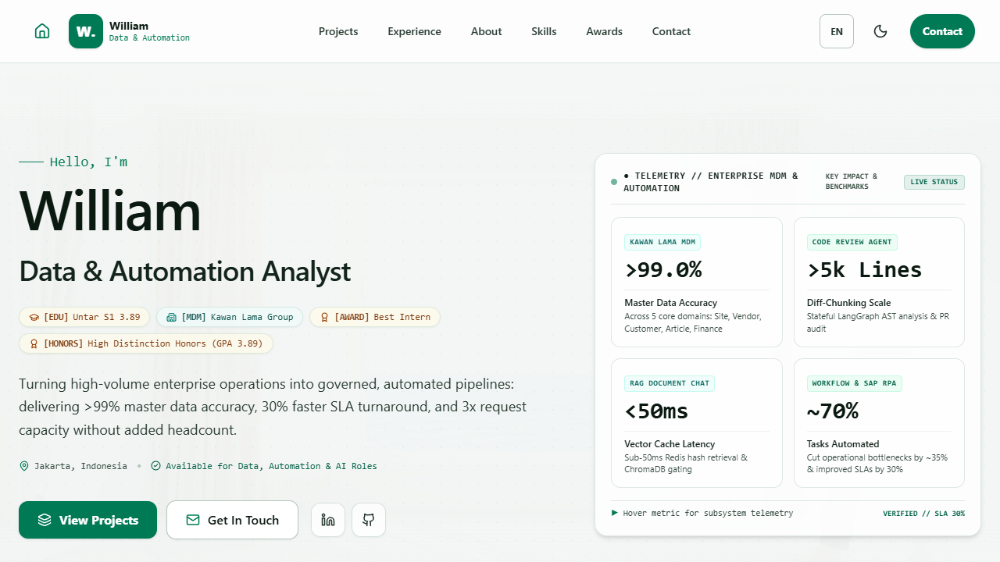
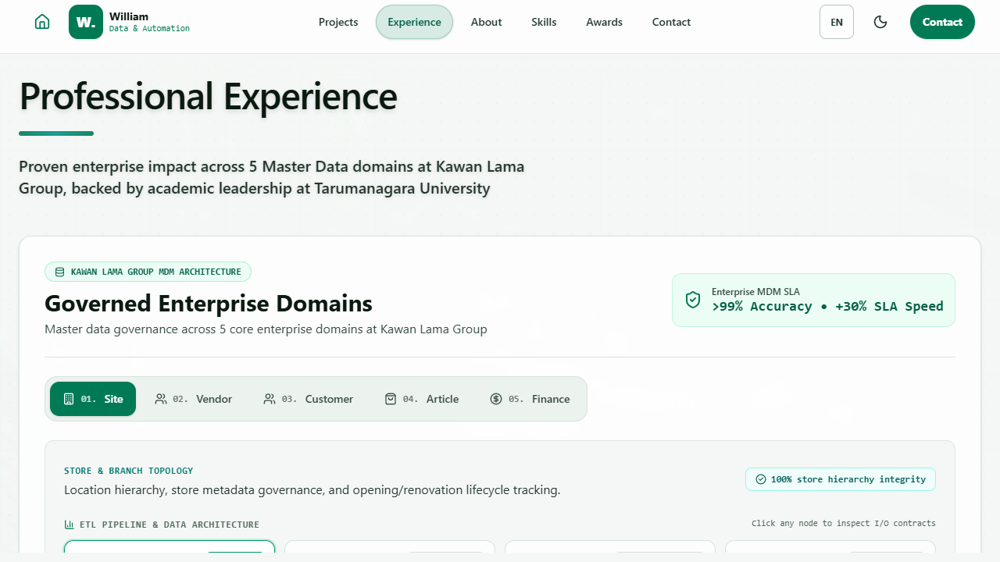

# William's Portfolio

Personal portfolio for William, a Data & Automation Analyst based in Jakarta. The site documents production work from Kawan Lama Group (Master Data Management across Site, Vendor, Customer, Article, and Finance domains), academic background at Tarumanagara University (S1 Informatics, GPA 3.89), eight technical projects, and a searchable directory of 87 verified credentials.

## Live Demo

Live Deployment: [myportofolio-prod.vercel.app](https://myportofolio-prod.vercel.app/)


[Watch full MP4 walkthrough](docs/media/demo.mp4)

## Screenshots

| Hero & Telemetry | Experience & MDM Domains |
| :---: | :---: |
|  |  |

## What's Inside

The portfolio is organized around verifiable work rather than static summary cards:

- Eight project case studies across AI systems, workflow automation, and analytics dashboards, each with interactive Mermaid architecture flowcharts and recorded media walkthroughs
- Interactive 4-node ETL pipeline and data-contract inspector covering five enterprise master data domains
- Searchable and filterable modal directory for 87 industry certifications from Google Cloud, AWS, DeepLearning.AI, IBM, Microsoft, Dicoding, and MySkill
- Bilingual English and Indonesian (`en` / `id`) interface backed by runtime Zod schema validation
- Light and dark modes with viewport-gated video playback that pauses off-screen, in background tabs, and under `prefers-reduced-motion: reduce`

## Projects Covered

1. AI Code Review Agent (stateful LangGraph multi-agent AST analysis and pull request auditing)
2. AI Document Chat with RAG (ChromaDB vector retrieval with Redis hash caching)
3. AI Writing Assistant SaaS (Next.js and TypeScript workspace with multi-provider LLM streaming)
4. Voice AI Assistant (real-time speech-to-speech pipeline using Whisper, Gemini Flash, and neural TTS)
5. Enterprise Workflow Automation Engine (Google Apps Script approval routing with distributed lock concurrency and SLA tracking)
6. SAP GUI Mass Data Creation RPA (Excel and VBScript automation for SAP master data batch execution)
7. Corporate KPI & SLA Analytics Dashboard (Python, SQL, and Streamlit operational analytics platform)
8. Multi-Model AI Content Generation Pipeline (structured prompt routing with schema validation and fallback handling)

## Tech Stack

- React 19 and Vite (Rolldown)
- Tailwind CSS 4
- Zod 4 for runtime data contract validation
- Mermaid for interactive architecture diagrams
- Vitest and React Testing Library (28 test suites, 939 automated tests)

## Local Development

Install dependencies and start the development server:

```bash
npm install
npm run dev
```

Run verification checks:

```bash
npm run lint
npm test -- --run
npm run build
```

## Contact

Email: [wiliamzwili135@gmail.com](mailto:wiliamzwili135@gmail.com)
